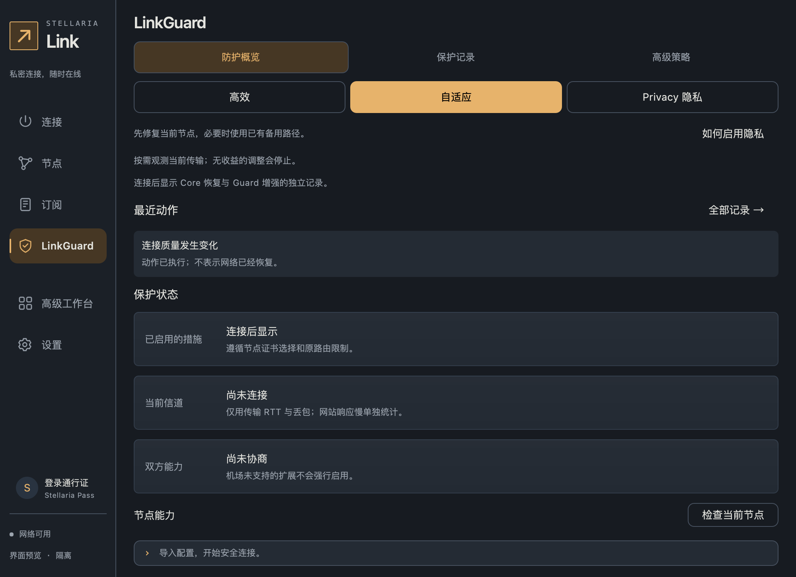
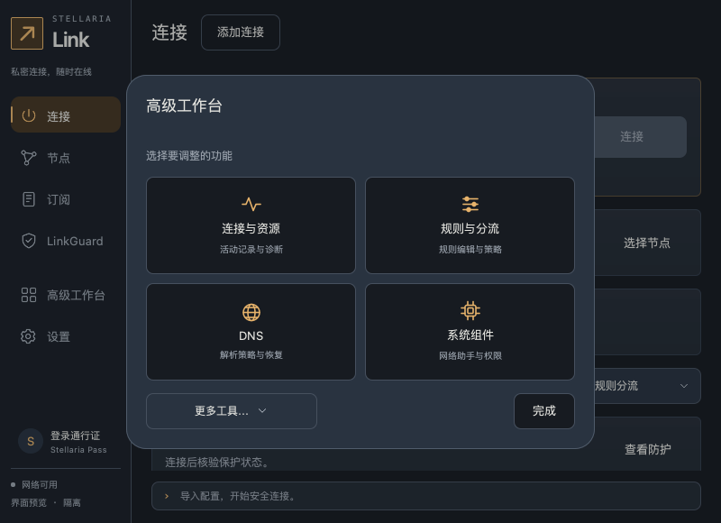

# Stellaria Link

**A focused VPN client for everyday connectivity.**

[Download Public Beta](https://github.com/Stellaria-Studio/Stellaria-Link-Releases/releases/download/v0.10.3/Stellaria-Link-0.10.3-0J03b-macOS-arm64.dmg) · [Release notes](https://github.com/Stellaria-Studio/Stellaria-Link-Releases/releases/tag/v0.10.3) · [Getting started](#getting-started) · [简体中文](README.md)

**0.10.3 · 0J03b**　|　macOS · Apple Silicon　|　Public Beta update

Stellaria Link brings encrypted connections, node selection, routing rules and connection maintenance into a compact desktop app. LinkCore owns data transport and connection lifetimes; LinkGuard observes channel conditions and applies recovery strategies when needed.

## What’s new in 0J03b

- Fixes explicitly approved node certificate-risk choices being lost after hostname resolution or network-interface changes.
- Prepares required GEO data during import so supported policy groups and routing rules are retained. The cache refreshes on demand after 24 hours, with validated cached data retained when offline.
- Adjusts full-configuration preflight timeouts and certificate-risk messaging.

## Why Link

| Feature | What it brings |
| --- | --- |
| Quick setup | Paste a provider subscription, import node links or load a YAML configuration, then connect from the home page. |
| Independent LinkCore | Stellaria's connection scheduling, resource management and recovery logic support Hysteria2, Trojan, VLESS and other protocols. |
| Flexible routing | Manage nodes and policy groups, edit rules in the GUI, and switch nodes or update rules while connected. |
| Visible LinkGuard | View channel status, protection measures and recent actions; choose Efficiency, Adaptive or Privacy mode. |
| Efficient by design | Session reuse, buffer management and bounded sampling reduce extra work. |
| Ongoing updates | Refresh provider subscriptions on a schedule. Check signed app and Core updates from GitHub, then choose Update now or Later. |

## Getting started

1. Download the macOS Apple Silicon DMG from [Releases](https://github.com/Stellaria-Studio/Stellaria-Link-Releases/releases/tag/v0.10.3) and drag **Stellaria Link** into **Applications**.
2. Open Link and select **添加连接 (Add connection)** to paste an HTTPS subscription, import a node link or load an existing YAML configuration.
3. Test and select a node or policy group on the **节点 (Nodes)** page. Return home, choose a connection scope and select **连接 (Connect)**.
4. Manage configurations on the **订阅 (Subscriptions)** page. Enable scheduled refresh under **设置 → 桌面 → 机场自动更新 (Settings → Desktop → Provider auto-update)**.
5. Check app and Core updates under **设置 → 连接 → 检查更新 (Settings → Connection → Check for updates)**.
6. Select the account entry at the bottom of the sidebar to sign in, manage your account and display Link supporter status in the separate Stellaria Pass window.

| Connection scope | Use case |
| --- | --- |
| Application proxy | A local HTTP / SOCKS proxy for selected applications. |
| System proxy | Browsers and other applications that follow macOS system proxy settings. |
| Device VPN | Forward device traffic through macOS TUN; follow the first-use setup for the system network component. |

If macOS requests confirmation on the beta's first launch, use **System Settings → Privacy & Security** to open the downloaded Link app. Installing the device-mode network component for the first time requires administrator authorization.

## Nodes and connection quality

Search, sorting, manual tests and policy-group selection live together on the Nodes page. The home page shows the current node, response, connection quality and Core memory.

## LinkGuard

Efficiency, Adaptive and Privacy modes share the same connection security requirements. Channel status and records of recovery, isolation and switching have dedicated views.

## A compact desktop experience

Gunmetal and amber, rounded controls, glass layers and a focused workbench give everyday actions and advanced settings their own place.

## Licensing and open-source plans

**The current Public Beta is closed-source.** Upon the official release, Stellaria Link will open its source under a dual-licensing model: **AGPL v3 + Stellaria Commercial License (SCL)**. SCL provides a separate commercial licensing route for proprietary integration and other agreed commercial arrangements. Third-party components retain their respective licenses.

## Feedback

Share feedback and feature requests in [Issues](https://github.com/Stellaria-Studio/Stellaria-Link-Releases/issues), with your version, platform and reproduction steps.
