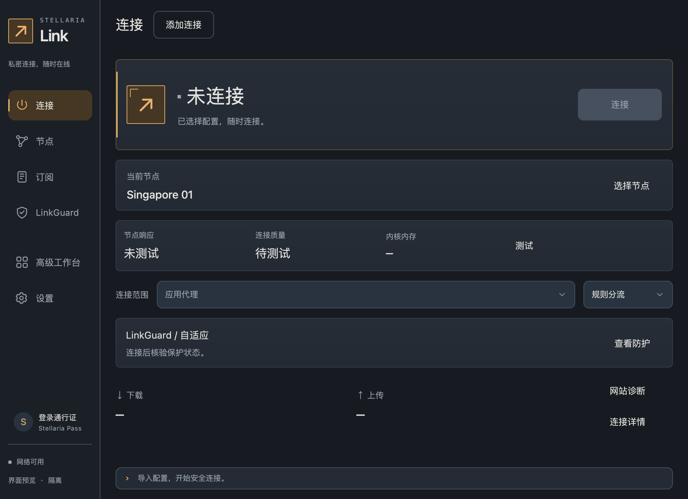
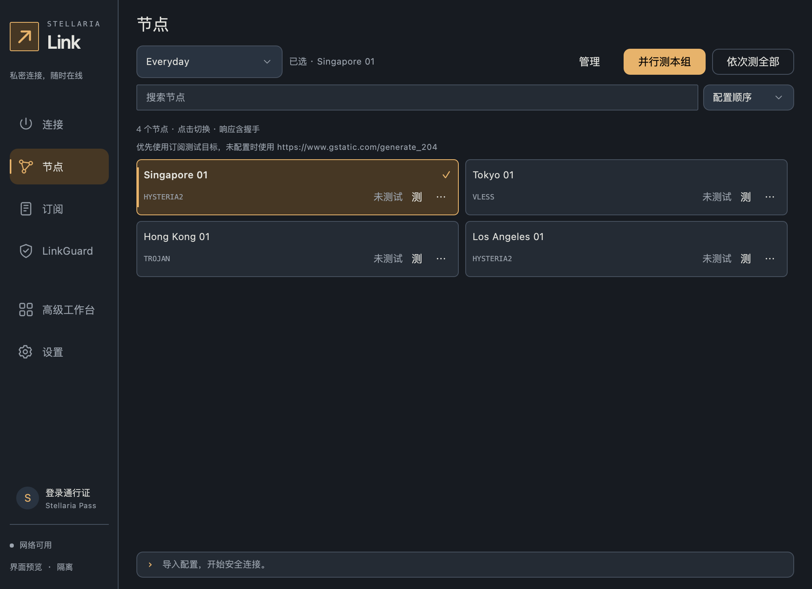

# Stellaria Link

**A focused VPN client for everyday connectivity.**

[Download Public Beta](https://github.com/Stellaria-Studio/Stellaria-Link-Releases/releases/download/v0.10.13/Stellaria-Link-0.10.13-0J13b-macOS-arm64.dmg) · [Release notes](https://github.com/Stellaria-Studio/Stellaria-Link-Releases/releases/tag/v0.10.13) · [Getting started](#getting-started) · [简体中文](README.md)

**0.10.13 · 0J13b**　|　macOS · Apple Silicon　|　Public Beta update

Stellaria Link brings encrypted connections, node selection, routing rules and connection maintenance into a compact desktop app. LinkCore owns data transport and connection lifetimes; LinkGuard observes channel conditions and applies recovery strategies when needed.

## Windows x64 preview

[Download Windows x64 ZIP](https://github.com/Stellaria-Studio/Stellaria-Link-Releases/releases/download/v0.10.11-windows.1/Stellaria-Link-0.10.11-0J11b-Windows-x64.zip) · [Windows notes and SHA-256](https://github.com/Stellaria-Studio/Stellaria-Link-Releases/releases/tag/v0.10.11-windows.1)

Includes local proxy, Windows system proxy and whole-device TUN. Extract the complete archive and run `Start-Link.cmd`. If required, install the included Microsoft `VC_redist.x64.exe`. The optional `Install-ForUser.ps1` installs for the current user and creates shortcuts.

For TUN, install the network helper from the advanced workbench and accept UAC once. Run the everyday desktop as a standard user. Switch during a dedicated window after exiting other VPNs. Disconnect or explicit recovery removes Link-owned network changes; protection survives service failure until explicit recovery. Avoid running two whole-device VPNs together.

Disposable Windows VM tests cover IPv4/IPv6 TCP, UDP, DNS, pause/resume, service crash protection and cleanup. This application is an unsigned preview. Windows process routing, hardware sleep/roaming and long-term stability remain unqualified. Windows updates are manual through Releases. Existing macOS guidance below continues to apply to macOS.

## What’s new in 0J13b for macOS

- The Nodes management menu opens below its button with an opaque background.
- Link can download and verify an app update while connected. Once it is ready, disconnect Link and choose Restart and Install to use the local package.
- To upgrade from an older client, download this release’s DMG while the VPN is connected, then quit Link to install it.

## What’s new in 0J12b for macOS

- Choose the nodes eligible for automatic switching directly on the Nodes page. Stable mode scores candidates at connection time and keeps the healthy exit.
- Link keeps retrying with backoff if the selected node or every authorized candidate is unavailable. The connection page offers node and subscription guidance.
- The macOS installer includes the updated App and LinkCore. Update the app and network helper when the current VPN session is idle.

## Why Link

| Feature | What it brings |
| --- | --- |
| Quick setup | Paste a provider subscription, import node links or load a YAML configuration, then connect from the home page. |
| Independent LinkCore | Stellaria's connection scheduling, resource management and recovery logic support Hysteria2, Trojan, VLESS and other protocols. |
| Flexible routing | Manage nodes and policy groups, edit rules in the GUI, and switch nodes or update rules while connected. |
| Visible LinkGuard | View channel status, protection measures and recent actions; choose Efficiency, Adaptive or Privacy mode. |
| Efficient by design | Session reuse, buffer management and bounded sampling reduce extra work. |
| Ongoing updates | Refresh provider subscriptions on a schedule. Check signed app and Core updates from GitHub, then choose Update now or Later. |

## Getting started

1. Download the macOS Apple Silicon DMG from [Releases](https://github.com/Stellaria-Studio/Stellaria-Link-Releases/releases/tag/v0.10.13) and drag **Stellaria Link** into **Applications**.
2. Open Link and select **添加连接 (Add connection)** to paste an HTTPS subscription, import a node link or load an existing YAML configuration.
3. Test and select a node or policy group on the **节点 (Nodes)** page. Return home, choose proxy access and Rule / Global routing and select **连接 (Connect)**.
4. Manage configurations on the **订阅 (Subscriptions)** page. Enable scheduled refresh under **设置 → 桌面 → 机场自动更新 (Settings → Desktop → Provider auto-update)**.
5. Check app and Core updates under **设置 → 连接 → 检查更新 (Settings → Connection → Check for updates)**.
6. Select the account entry at the bottom of the sidebar to sign in, manage your account and display Link supporter status in the separate Stellaria Pass window.

| Proxy access | Use case |
| --- | --- |
| Local proxy only | Start a local HTTP / SOCKS port; configure its address in the app. Host proxy settings and routes stay unchanged. |
| System proxy | Browsers and other applications that follow macOS system proxy settings. |
| TUN mode | Receive application traffic through a virtual interface and apply Rule / Global routing; follow first-use setup for the network component. |

If macOS requests confirmation on the beta's first launch, use **System Settings → Privacy & Security** to open the downloaded Link app. Installing the TUN network component for the first time requires administrator authorization. Complete the system Terminal authorization in **Settings → Network helper**, then wait for Link to confirm that the helper is installed and ready before connecting. The TUN node-resolution fix requires the new network helper; an already installed older helper must also be updated.

## Nodes and connection quality

Search, sorting, manual tests and policy-group selection live together on the Nodes page. The home page shows the current node, response, connection quality and Core memory.

## LinkGuard

Efficiency, Adaptive and Privacy modes share the same connection security requirements. Channel status and records of recovery, isolation and switching have dedicated views.

## A compact desktop experience

Gunmetal and amber, rounded controls, glass layers and a focused workbench give everyday actions and advanced settings their own place.

## Licensing and open-source plans

**The current Public Beta is closed-source.** Upon the official release, Stellaria Link will open its source under a dual-licensing model: **AGPL v3 + Stellaria Commercial License (SCL)**. SCL provides a separate commercial licensing route for proprietary integration and other agreed commercial arrangements. Third-party components retain their respective licenses.

## Feedback

Share feedback and feature requests in [Issues](https://github.com/Stellaria-Studio/Stellaria-Link-Releases/issues), with your version, platform and reproduction steps.
