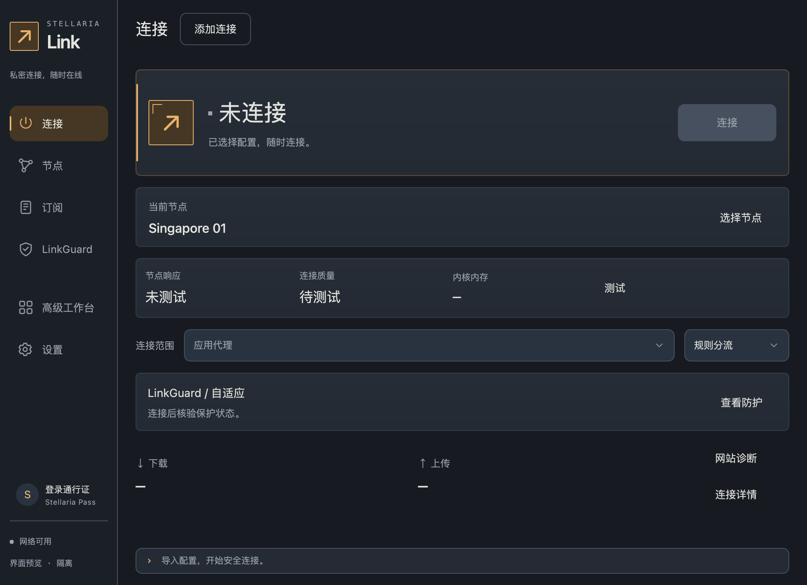
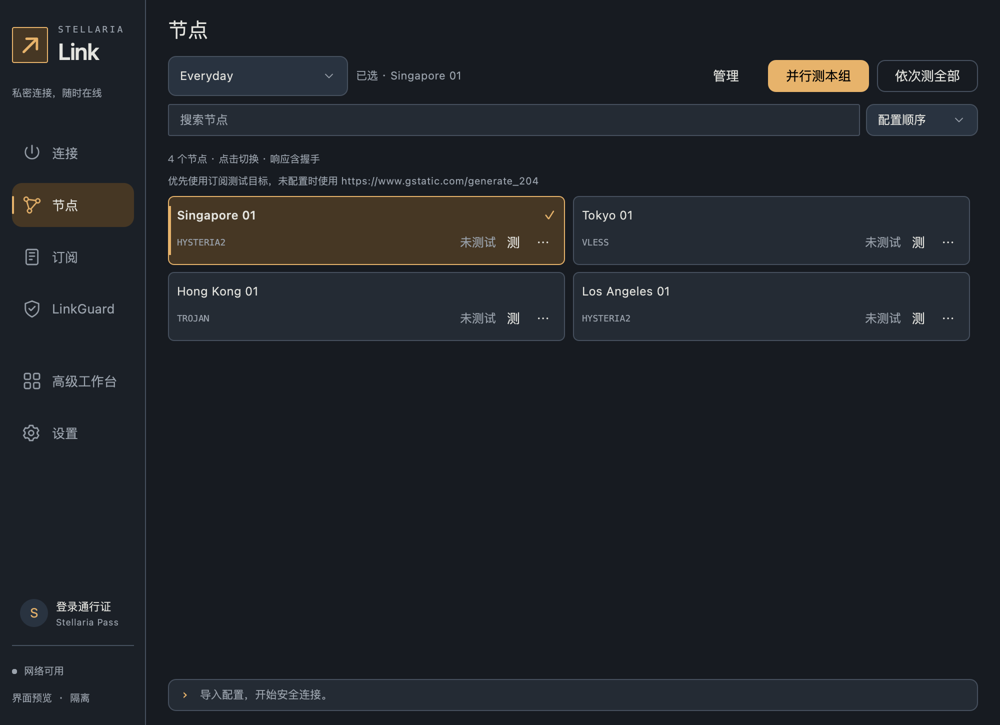
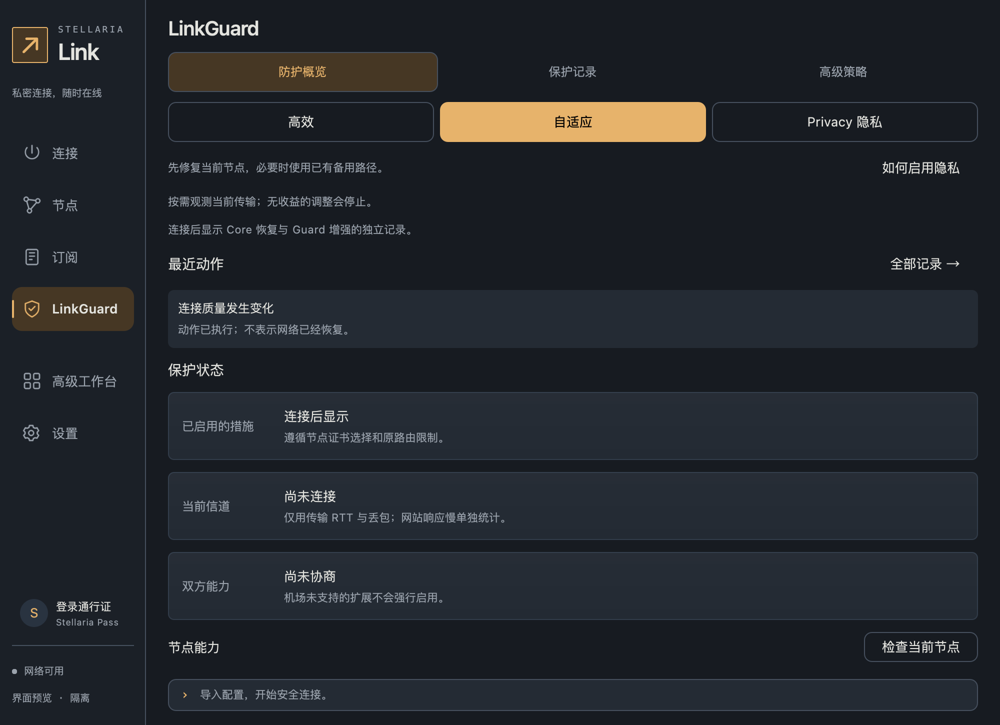
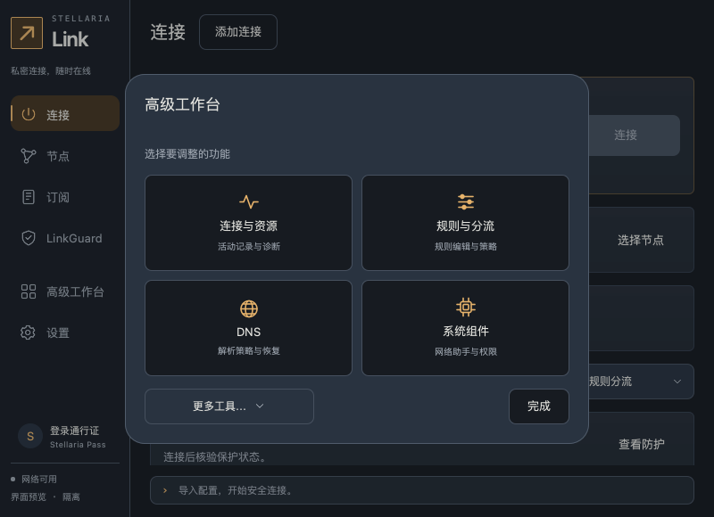

# Stellaria Link

**为日常连接而设计的 VPN 客户端。**

> **0J04b 已暂停下载：macOS 安装包存在启动故障。当前临时提供 0J03b，0J05b 修复版验收中。** [查看故障说明](https://github.com/Stellaria-Studio/Stellaria-Link-Releases/releases/tag/v0.10.4)

[下载 Public Beta](https://github.com/Stellaria-Studio/Stellaria-Link-Releases/releases/download/v0.10.3/Stellaria-Link-0.10.3-0J03b-macOS-arm64.dmg) · [发行说明](https://github.com/Stellaria-Studio/Stellaria-Link-Releases/releases/tag/v0.10.3) · [快速开始](#快速开始) · [English](README.en.md)

**0.10.3 · 0J03b**　｜　macOS · Apple Silicon　｜　Public Beta 更新

Stellaria Link 将加密连接、节点选择、规则分流与连接维护整合进一个紧凑的桌面面板。LinkCore 负责数据传输与连接生命周期，LinkGuard 观察信道状态并按需执行恢复策略，让日常连接更容易管理。

## 0J03b 更新

- 修复已确认的节点证书风险选择在域名解析或网络接口变化后失效的问题。
- 首次导入自动准备所需 GEO 数据，保留支持的策略组与分流规则；缓存每 24 小时按需刷新，离线时保留已验证的缓存。
- 调整完整配置预检的等待时间与证书风险提示。

## 为什么选择 Link

| 功能 | 使用体验 |
| --- | --- |
| 快速接入 | 粘贴机场订阅、导入节点链接或 YAML 配置，从首页开始连接。 |
| 自主 LinkCore | 以自主的连接调度、资源管理与恢复逻辑，统一承载 Hysteria2、Trojan、VLESS 等协议。 |
| 灵活分流 | 管理节点与策略组，通过图形界面编辑规则，在线切换节点与更新规则。 |
| 看得见的 LinkGuard | 在同一页查看信道状态、防护措施和最近动作，选择高效、自适应或 Privacy 模式。 |
| 低开销设计 | 通过会话复用、缓冲管理和有界采样减少额外工作。 |
| 持续更新 | 定时更新机场订阅；软件和内核从 GitHub 检查签名更新，由你选择立即更新或稍后。 |

## 快速开始

1. 在 [Releases](https://github.com/Stellaria-Studio/Stellaria-Link-Releases/releases/tag/v0.10.3) 下载 macOS Apple Silicon 的 DMG，将 **Stellaria Link** 拖入 **Applications**。
2. 打开 Link，点击 **添加连接**，粘贴机场 HTTPS 订阅、节点链接，或导入已有 YAML 配置。
3. 在 **节点** 页测试并选择节点或策略组，回到首页选择连接范围，点击 **连接**。
4. 在 **订阅** 页管理配置；在 **设置 → 桌面 → 机场自动更新** 开启定时更新。
5. 在 **设置 → 连接 → 检查更新** 获取软件或内核新版。
6. 点击侧栏下方的账户入口，在独立的 Stellaria Pass 窗口中登录、管理账户并展示 Link 支持者身份。

| 连接范围 | 适合的场景 |
| --- | --- |
| 应用代理 | 为指定应用提供本地 HTTP / SOCKS 代理。 |
| 系统代理 | 让浏览器等遵循系统代理的应用使用 Link。 |
| 整机 VPN | 通过 macOS TUN 转发整机流量，首次使用按引导安装系统网络组件。 |

首次打开若 macOS 提示无法验证开发者，可在 **系统设置 → 隐私与安全性** 中选择打开本次下载的 Link。整机模式的首次组件安装需要管理员授权。

## 节点与连接质量

搜索、排序、手动测试和策略组选择集中在节点页，首页同步显示当前节点、响应、连接质量与内核内存。

## LinkGuard

高效、自适应与 Privacy 三种模式，共享统一的连接安全要求。连接状态与恢复、隔离、切换等动作都有各自的记录入口。

## 紧凑而清晰的桌面体验

枪灰与琥珀色视觉、圆角控件、玻璃层次和集中的高级工作台，让常用操作与进阶设置各有位置。

## 许可与开源计划

**当前 Public Beta 为闭源公测版本。** 正式发布后，Stellaria Link 将开放源码，采用 **AGPL v3 + Stellaria Commercial License（SCL）** 双重授权。SCL 提供独立的商业授权路径，用于按约定进行专有集成等商业合作。第三方组件继续遵循各自的许可证。

## 反馈

欢迎在 [Issues](https://github.com/Stellaria-Studio/Stellaria-Link-Releases/issues) 提交使用反馈与功能建议，附上版本、平台和复现步骤。
